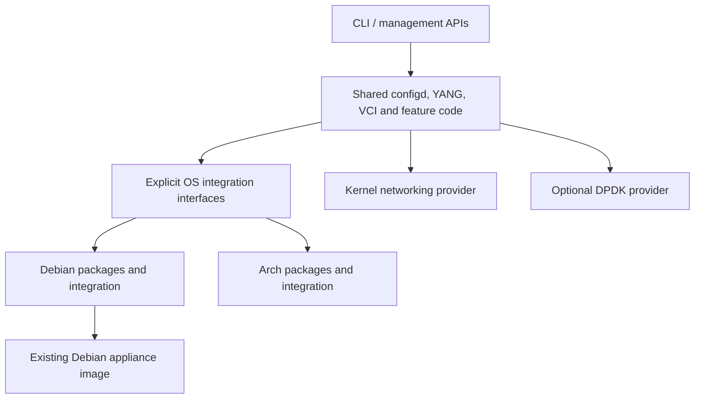

# NuDanOS revival review: native Debian and Arch

Review date: 2026-11-03. Requested outcome: revive the project on modern Debian first, and run it natively on Arch as well.

## Assessment

The existing Debian revival is a credible working foundation. It already replaces many obsolete vendor forks, uses Debian 13, runs kernel forwarding with modern FRR, builds an image, and exercises real boot and routing scenarios. Preserve that progress.

The next priorities are correcting management/security and configuration-state defects, making releases reproducible and authenticated, and extracting distribution integration from the runtime. Native Arch support is a substantial second runtime target; the documented ability to build Debian images on an Arch host does not deliver it.

I recommend a shared configuration/control/networking core, separate native Debian and Arch packaging/integration, and optional forwarding providers. Keep the existing Debian appliance image as a delivery target. Bring native kernel forwarding to both distributions before making the old DPDK/NPF/QoS pipeline a requirement.

## Coverage and limits

The organization contains **195 repositories**, of which **47 are archived**. All 195 are reconciled in [repository-coverage.csv](C:/Users/Jon/Documents/Projects/nudanos-review/review/repository-coverage.csv). The current manifest has 197 entries: 192 organization repositories and five external source packages. The three additional organization repositories are distro and legacy build tooling.

| Organization treatment | Repositories |
| --- | ---: |
| DANOS/NuDanOS source ports | 124 |
| Replaced by distribution Debian packages | 32 |
| Rebuilt from maintained upstream source | 10 |
| Mirrored upstream FRR packages | 1 |
| Dropped | 15 |
| Historical/reference | 10 |
| Build/orchestration tooling | 3 |
| Total | 195 |

There are 96 ready DANOS source entries, 11 ready upstream-source entries (including external packages), and one ready APT entry in the manifest. None of the archived repositories is selected as an actively maintained DANOS source port.

The review used distro commit `864370dc3ff5a6086ce298b147f79ac2c4de315e`, focused static inspection across 67 component checkouts plus distro, organization metadata, manifest/package reconciliation, existing tests, and actual CI logs. Preserved defaults were examined for deferred components; active ports were reviewed on their selected `trixie` branches. The inventory distinguishes focused review from inventory-only triage.

This is an organization-wide engineering assessment, **not an exhaustive line-by-line audit of all 195 repositories**, a penetration test, or a certification of native Linux compatibility. Large archived vendor trees were classified, not re-audited in full. Source defects below were verified in the code; their runtime consequences still require the listed Linux regression tests. No production code, remote branches, issues, or pull requests were changed.

## Verified current state

[The November 3 nightly](https://github.com/nudanos/distro/actions/runs/41652774933) completed successfully. Its log records:

- Install/remove/purge of the full 1,097-package dependency closure.
- BIOS boot, configure/install/reboot, and UEFI smoke boot.
- 39 captured DANOS 2105 configuration fixtures.
- Passing BGP, OSPF, REST, SNMP, TACACS, and VRRP gating scenarios.
- Passing MPLS/LDP, which remains reported-only rather than release-gating.
- Lint: 9,923 findings across 48 ports, with 95 ports checked. These are mixed formatting/style/correctness findings, not 9,923 confirmed bugs.

[The current distro commit's unit CI](https://github.com/nudanos/distro/actions/runs/39957309285) also passed. Locally, 8 launch tests and 42 tooling tests passed with the bundled Python runtime. The tooling tests needed a writable workspace temporary directory because this session's default sandbox temp directory denied file access.

Linux package builds, native service activation, router VMs, Go tests, and Arch tests were not run locally: this Windows session has no installed Linux runtime/container engine or usable Go toolchain. CI evidence is identified separately from local execution. See [ci-evidence.json](C:/Users/Jon/Documents/Projects/nudanos-review/ci-evidence.json).

The latest [nightly release](https://github.com/nudanos/distro/releases/tag/nightly-20261103) explicitly says milestone 1 has no firewall, NAT, or QoS. The old preservation report's broad statements about obsolete Go, debhelper 9, old FRR, and missing build infrastructure are historical; they should not be presented as the state of today's active ports.

## Findings to address before wider deployment

Priority 1 means address before broader deployment or a trusted release; priority 2 means the next correctness/portability work. Exposure conditions matter: local socket issues are not remote unauthenticated exploits, and deferred components are not current kernel-mode services.

### 1. Migration discards firewall policy and proceeds with kernel forwarding — P1

The kernel-forwarding boot hook removes `security firewall`, interface firewall bindings, `service nat`, and QoS from imported configurations. It backs up the original and writes a notice, but then successfully loads the remainder. Existing tests expressly expect the firewall policy/bindings to disappear.

A configuration that formerly denied transit can therefore boot with its protection removed. This is a dangerous migration contract even though the milestone's lack of firewall support is documented.

**Recommendation:** separate harmless unsupported tuning from security policy. When a security policy cannot be translated/enforced, retain a recovery/management path and block transit until the migration is deliberately resolved. A login notice is insufficient enforcement. Test real denied packets before/after migration, failed conversion, reboot, and recovery.

Evidence: [removed paths](https://github.com/nudanos/vyatta-kernel-forwarding/blob/471ce7e62166d3966b6a648dcff870ebba955229/dpdk-only-paths#L9), [boot-file replacement](https://github.com/nudanos/vyatta-kernel-forwarding/blob/471ce7e62166d3966b6a648dcff870ebba955229/boot-config.d/50-dpdk-set-aside#L158).

### 2. REST session storage permits local administrator impersonation when REST is enabled — P1

The startup helper creates `/var/run/gui` and makes it writable by everyone, without a sticky bit. The session authenticator trusts records in `/var/run/gui/session`, accepts a token and timestamp, resolves the record's named system user, and switches identity/groups. The session authenticator is registered unconditionally.

A local user able to access that directory can replace the session file and supply a record for an existing administrator. Restricting the file alone would not repair an attacker-writable parent directory. This is a source-confirmed local authentication boundary defect; no live exploitation was performed.

**Recommendation:** root/service-owned runtime directory, restricted ownership/mode, safe atomic file handling, and a narrowly defined session issuer/validator. Remove the legacy session mechanism if unused. Test a low-privilege account attempting directory/file replacement, symlink substitution, token tampering, expiration, and cross-user access.

Evidence: [directory permissions](https://github.com/nudanos/vyatta-rest/blob/a520840d1bc51a9bef4d86bb61bd2105068fb2a7/scripts/vyatta-webgui-chunker-aux#L38), [session validation and identity selection](https://github.com/nudanos/vyatta-rest/blob/a520840d1bc51a9bef4d86bb61bd2105068fb2a7/src/server/authsession.cc#L223). See the control-plane review for the complete authenticator chain.

### 3. Unset audit login identity becomes root in configd — P1, authorization impact needs a Linux negative test

configd reads Unix peer credentials, then replaces the peer UID with the audit login UID. When loginuid is unset, `getLoginUid` returns UID 0 plus a special error; the connection handler explicitly tolerates that error. It constructs a root/superuser context. This condition is normal for some daemon/service processes and is especially relevant to a new distro integration.

Source shows incorrect authority attribution, session ownership bypass, and root caller selection for some helpers. It does **not** establish that every configuration authorization check is bypassed; data ACM still applies.

**Recommendation:** preserve kernel-authenticated peer identity; use audit identity for attribution or constrained delegation. Distinguish trusted internal daemon calls explicitly and fail closed on invalid identity. Test an unprivileged service with unset loginuid, PAM users, sudo transitions, and legitimate internal callers on both targets.

Evidence: [fallback and credential replacement](https://github.com/nudanos/configd/blob/240e958c481b5024620a5599a665f5b31c222ec4/server/conn.go#L103), [error handling/context](https://github.com/nudanos/configd/blob/240e958c481b5024620a5599a665f5b31c222ec4/server/conn.go#L143).

### 4. Password verify/change RPC still imports Python's removed crypt module — P1 functional blocker

`vyatta-password-rpc` unconditionally imports `crypt`; Debian 13 uses Python 3.13, where it is removed. The inspected package does not provide the compatibility module. The installed PAM password module calls these verify/change RPCs, so self-service password workflows can fail even though boot/configuring a password through another path succeeds.

**Recommendation:** implement the supported password-verification path using the platform's authentication/crypt facilities, with explicit dependencies and tests. A compatibility module is a tactical option only after validating hashing behavior on both distributions. Cover correct/wrong current passwords, hash formats, expired accounts, and password changes.

Evidence: [import and use](https://github.com/nudanos/vyatta-login/blob/64c15c933f59ae552e8044dbd70a6f2d13e6c99b/scripts/vyatta-password-rpc#L11), [PAM RPC call](https://github.com/nudanos/vyatta-login/blob/64c15c933f59ae552e8044dbd70a6f2d13e6c99b/src/pam_vyatta_passwd/pam_vyatta_passwd.c#L72).

### 5. Enabling automatic login disabling installs an obsolete required PAM module — P1 conditional lockout

The login configuration generates required `pam_tally.so` rules, while modern Debian no longer ships that module. Related scripts still invoke `pam_tally`. Enabling this feature can break PAM authentication rather than deliver the intended lockout policy.

**Recommendation:** implement distro-specific lockout integration with supported PAM modules, validate availability before committing, and preserve console recovery. Test the failure threshold, successful reset, timeout, root/admin behavior, remote AAA users, disabled feature, package upgrade, and rollback.

Evidence: [generated required rules](https://github.com/nudanos/vyatta-login/blob/64c15c933f59ae552e8044dbd70a6f2d13e6c99b/usr/share/pam-configs/vyatta-pam-tally.template#L6), [activation](https://github.com/nudanos/vyatta-login/blob/64c15c933f59ae552e8044dbd70a6f2d13e6c99b/scripts/system/vyatta_update_login.pl#L85).

### 6. Image update authenticity is optional — P1 release trust

The downloader tolerates a missing detached signature, and installation verifies a signature only if the `.asc` exists. An invalid signature can also be overridden interactively. Verification defaults to the legacy generic APT keyring. Current nightly assets are an ISO and SHA256 sidecar, not an end-to-end signed release contract.

**Recommendation:** publish and require a signed release manifest binding the ISO and source lock. Verify against a dedicated shipped NuDanOS trust root before installation; define key rotation/revocation and rollback policy. Deliberate local development-image installation should be an explicit separate action with a recorded state. Test missing, corrupt, wrong-key, expired, replayed, and valid releases.

Evidence: [optional verification](https://github.com/nudanos/vyatta-image-tools/blob/0405dbdeb2818a4f19136730610cb4ba87058c75/scripts/vyatta-install-image.functions#L1974), [verification/override](https://github.com/nudanos/vyatta-image-tools/blob/0405dbdeb2818a4f19136730610cb4ba87058c75/scripts/vyatta-install-image.functions#L1795), [release publication](https://github.com/nudanos/distro/blob/864370dc3ff5a6086ce298b147f79ac2c4de315e/.github/workflows/nightly.yml#L137).

### 7. Failed interface actions become successfully applied running state — P1/P2

ifmgrd prints commit-action errors but returns success/change=true. The state machine then stores the candidate as running and emits configuration-updated. A rejected MTU, address, or VRF action can leave acknowledged configuration and kernel state different; repeating the same configuration need not retry.

**Recommendation:** distinguish no change, success, and failure; advance applied state only on success. Expose failures to the management plane and reconcile/retry safely. Add injected-action failure and hotplug tests, including reapplying the same candidate after the failure clears.

Evidence: [discarded errors](https://github.com/nudanos/ifmgrd/blob/40e22ccdfd43ab7f408c9fca459625a4d25cc195/intf_state_machine.go#L182), [running-state advance](https://github.com/nudanos/ifmgrd/blob/40e22ccdfd43ab7f408c9fca459625a4d25cc195/intf_state_machine.go#L239).

### 8. Null RPC arguments can panic management daemons — P2 availability

configd and ifmgrd use reflection on decoded JSON arguments without checking whether `reflect.TypeOf(v)` is nil. A null argument to a recognized, permitted method can panic the process. configd's socket declares mode 0777; ifmgrd uses a more restricted group socket. Reachability and method authorization must be assessed independently of the nil dereference.

**Recommendation:** typed argument decoding/validation and controlled recovery at RPC boundaries. Reject null, wrong types/counts, unknown methods, oversized and truncated input without losing the process. Add fuzzing and process-survival tests.

Evidence: [configd dispatch](https://github.com/nudanos/configd/blob/240e958c481b5024620a5599a665f5b31c222ec4/server/conn.go#L258), [ifmgrd dispatch](https://github.com/nudanos/ifmgrd/blob/40e22ccdfd43ab7f408c9fca459625a4d25cc195/conn.go#L202).

### 9. VCI accepts malformed signals without validating the sender or body — P1 local availability

The bundled bus policy permits local users to send signals. VCI subscribes by interface/member, then indexes the first body element and asserts it is a string before validating content. An empty or non-string body can panic a subscribed component; valid content is also not proof of an authorized producer.

**Recommendation:** validate body length/types before access, authorize signal producers, and exercise malformed/unauthorized D-Bus signals while requiring subscribers to remain alive. The exact reachable subscribers depend on the installed models and policy. This is a local bus finding, not an established remote attack.

Evidence: [bus policy](https://github.com/nudanos/vci/blob/0499b9e2b4c5ee7883e0f0c397685cfd26d762c4/vcidbus/vyatta-vci-bus.conf#L32), [unchecked body](https://github.com/nudanos/vci/blob/0499b9e2b4c5ee7883e0f0c397685cfd26d762c4/dbus_transport.go#L137).

### 10. Other confirmed correctness defects — P2, with REST parsing treated as P1

| Defect | Consequence | Correction/test |
| --- | --- | --- |
| REST Basic auth decodes into an uninitialized buffer, then constructs a C-string without adding a terminator or validating decoded length | Pre-auth out-of-bounds/uninitialized reads; plaintext credentials also enter debug logs when debugging is enabled | Length-bounded parsing, reject decode errors, remove credential logging; ASan malformed/long/empty headers |
| Password PAM helper interpolates raw passwords into JSON | Quotes/backslashes can break or alter the RPC payload | Proper JSON serialization; round-trip punctuation, Unicode, long passwords |
| YANG accepts 16-character VRF names; implementation permits 12 and returns success on refusal | Accepted configuration may never provision its VRF; FRR can wait indefinitely | Align limits, propagate failure; test lengths 12/13/16 |
| MPLS setup ignores errors and only enables interface input | Successful commit despite failed sysctl; removal can leave MPLS enabled | Old/new reconciliation, disable removed state, fail on write errors |
| PAM package removal deletes all lines beginning `password` from /etc/pam.d/passwd; auditd diversion restore checks the wrong location | Damages host-owned authentication configuration during removal/rollback | Restore only owned edits/diversions; verify contents and working authentication after remove/reinstall |
| User-isolation activation ignores pam-auth-update errors and exits 0 | Reports isolation enabled when activation failed; incompatible with native Arch integration | Distro adapter, failure propagation, recovery/negative tests |
| configd ignores recovery-file write errors after publishing in-memory state and uses a truncating writer | Commit can report success while restart recovery state is missing or partial | Atomic replacement and observable persistence failure; test full/read-only filesystem and restart |

Further portability defects include an amd64 Debian PAM module install path fixed in the shared Makefile and legacy SSSD wrapper code using an option removed from current upstream SSSD. The latter was reproduced against the schema API, but is not proof that the already-migrated current TACACS+ path fails. Service lifecycle scripts also delete SysV links without establishing complete native systemd/socket ownership. See the packaging notes for scope and exact locations.

The control-plane, networking, and packaging notes contain exact source locations and exposure conditions for these items.

Selected evidence: [REST counted-buffer handling](https://github.com/nudanos/vyatta-rest/blob/a520840d1bc51a9bef4d86bb61bd2105068fb2a7/src/server/authbasic.cc#L127), [VRF schema limit](https://github.com/nudanos/routing-instance/blob/a5982b5731bd351982f9d2f250dcec39a4e5e6db/yang/vyatta-routing-v1.yang#L79), [ignored MPLS error](https://github.com/nudanos/vyatta-protocols-frr/blob/7b3c841394f68e01dba37b88053f1a20971ae4e7/cmd/frr/main.go#L119), [PAM removal](https://github.com/nudanos/vyatta-debian-pam-configs-config/blob/e8502d8d0e8b59bc95cbb77a79258886d20fea52/debian/postrm#L41), [recovery write](https://github.com/nudanos/configd/blob/240e958c481b5024620a5599a665f5b31c222ec4/session/commitmgr.go#L161).

### 11. Release inputs and build caches are not sufficiently locked — P2

All 96 ready DANOS entries follow floating trixie branches. Build and lint separately re-fetch sources. Release identity is based on distro commit/date, while component branches, Debian archives and image dependencies can change independently. Upstream packaging pins already provide a good pattern to extend.

The package cache salt uses the builder directory's content hash, not the actual built image ID/external dependency set. Rebuilding the same Dockerfile against updated Debian packages can still reuse old outputs.

**Recommendation:** resolve a complete immutable source/dependency lock once; build, lint, test, sign and publish that exact set. Bind image version/provenance to it. Include actual builder identity and dependency snapshot in cache keys; periodically perform independent clean rebuilds. Preserve the current source/transitive-dependency invalidation, which is useful.

Evidence: [fetch](https://github.com/nudanos/distro/blob/864370dc3ff5a6086ce298b147f79ac2c4de315e/cmd/distro-build/main.go#L136), [builder salt](https://github.com/nudanos/distro/blob/864370dc3ff5a6086ce298b147f79ac2c4de315e/cmd/distro-build/main.go#L286), [cache key](https://github.com/nudanos/distro/blob/864370dc3ff5a6086ce298b147f79ac2c4de315e/internal/build/build.go#L197).

### 12. Update/cache validation has blind spots — P2

A mirrored APT cache hit requires only one .deb; it does not re-verify every pinned package. An incomplete cache can be accepted until later install/image steps fail. The weekly updater also silently ignores a pinned package name absent from the upstream index.

**Recommendation:** verify each expected binary/source artifact, version, architecture and checksum on cache hits; repair partial caches. Report missing upstream packages as unavailable, not current. Add missing-file, truncated-artifact, empty-index and disappearing-package tests.

Evidence: [mirror fast path](https://github.com/nudanos/distro/blob/864370dc3ff5a6086ce298b147f79ac2c4de315e/internal/aptmirror/aptmirror.go#L71), [missing-name handling](https://github.com/nudanos/distro/blob/864370dc3ff5a6086ce298b147f79ac2c4de315e/internal/updates/updates.go#L92).

### 13. Deferred DPDK/FPM work has a separate security and compatibility gate

The preserved route-broker binds FPM to all IPv4 addresses, accepts the first connection without authentication, then closes its listener. It must be corrected before restoration. It is deferred to milestone 2 and is not an active kernel-mode service.

The full DPDK stack also depends on fork-specific APIs/features, controller/protobuf/FPM behavior and NPF/QoS semantics. Modernizing only symbol names is insufficient. Review packet-parsing hardening, PMDs, hugepages/VFIO, supported kernels, reconnect/full FIB resync, VRF/ECMP/MPLS and policy behavior as a separate provider.

Evidence: [route-broker listener](https://github.com/nudanos/vyatta-route-broker/blob/8ee9162d55e8e0e02672acfceb44f562b4b34662/daemon/broker_main.c#L63). Deferred branch gaps are roadmap incompleteness, not a current milestone 1 build failure.

## Architecture for native Debian and Arch

The target should be the same product behavior and configuration semantics on both bases, with distribution-native dependencies and package lifecycle management.

### Shared core

- Keep configd/YANG/VCI and the transactional CLI as the main assets. Avoid a wholesale language rewrite; correct privileged boundaries and state handling first.
- Give core repositories independently usable build/check/staged-install targets. Debian packaging currently contains build behavior, version queries and even source transformations; move those semantics into shared build code before translating packaging.
- Introduce a pinned Go module/workspace dependency strategy while preserving validated import identities and reproducible/offline builds. Rebuild Go plugins with their consumers using the same toolchain and dependency graph; the AAA plugin API integer does not guarantee binary compatibility.
- Make runtime/state/model/plugin paths configurable. A staged DESTDIR install must not edit the host. Preserve legacy paths initially where needed, then migrate deliberately.
- Generate dependency/model metadata from a shared capability catalog. Debian's very large per-YANG package set should not require manually maintaining a parallel set of Arch files.
- Expose actual feature support to schema/CLI validation. Unsupported firewall/VPN/DHCP/dataplane features must not appear to have succeeded.

### Distribution integration

| Concern | Debian target | Native Arch target |
| --- | --- | --- |
| Packaging/build | Existing debhelper packages, clean build environments | PKGBUILDs built from the same locked source, clean chroots |
| Build dependency names | Debian package mapping | Arch package mapping and package-specific ABI checks |
| PAM/NSS/login | Explicit Debian common-* / pam-auth-update integration | Explicit Arch PAM/NSS integration; no Debian helper assumptions |
| Services | Shared systemd units plus Debian settings | Shared systemd units plus Arch settings/users/tmpfiles |
| Network ownership | Appliance ownership or explicit native-host adoption | Explicit NIC/VRF/FRR/DNS ownership on native hosts or an Arch appliance |
| Update delivery | Signed APT packages; separately signed appliance images | Signed pacman repository/packages; any future image updater separate |
| Boot/install | Existing live-build/live-boot/initramfs-tools/GRUB path | Native rootfs/VM first; choose and test native boot/image tooling separately |
| Package removal | Restore owned edits/diversions and functional login/network | Native lifecycle hooks; preserve host files/settings not owned by NuDanOS |

Arch's native packaging model provides prepare/build/check/package stages, and its tooling supports clean-chroot package builds. Use those directly rather than converting or unpacking Debian binaries. References: [PKGBUILD manual](https://man.archlinux.org/man/PKGBUILD.5), [pkgctl build](https://man.archlinux.org/man/pkgctl-build.1.en).

The existing runtime assumes appliance ownership in several places: NIC renaming, global local-routing-rule priority changes, FRR global configuration, PAM, NSS, and Debian identity/boot files. A dedicated appliance may intentionally own these resources. Installation into an existing Debian or Arch host must instead acquire only declared resources and detect existing managers/configuration. Keep an excluded management/recovery path.

### Forwarding direction

For initial native support, keep kernel forwarding on both distributions. Then choose deliberately between:

1. **Kernel provider with nftables/tc/XFRM capabilities:** closer to distribution-native routing, with considerable work to map old firewall/NAT/QoS/VPN semantics.
2. **Restored DPDK/NPF provider:** preserves distinctive DANOS behavior/performance but has a larger API, driver, security and maintenance burden.

My recommendation is kernel-native baseline and management protection first, with DPDK optional later. Full feature parity is a separate commitment; do not imply that old NPF configuration automatically translates to nftables. Keep hardware SDK/BSP restoration out of the initial portability dependency chain unless specific hardware becomes a requirement.

## Suggested delivery sequence

These are recommended work packages and exit criteria, not time estimates or an implementation already approved.

| Order | Work | Exit criterion |
| --- | --- | --- |
| 1 | Management/security correctness | REST session replacement rejected; audit identity handled safely; RPC fuzzing survives; password/lockout paths work; imported policy cannot silently disappear |
| 2 | Trustworthy Debian baseline | Signed mandatory release verification; locked inputs; clean reproducible build; install/upgrade/remove preserves functional authentication and declared network state |
| 3 | Shared runtime/build contract | Core builds/stages without dpkg execution; paths/users/services/capabilities specified; Debian continues passing existing scenarios |
| 4 | Native Arch kernel-mode minimum | Native packages install in an Arch VM/rootfs; CLI/configd/VCI, interfaces, VRFs, static routes and FRR work; reboot/upgrade/remove and recovery pass |
| 5 | Cross-distribution service coverage | DNS, SNMP, AAA and other declared features pass the same positive and negative scenarios on both |
| 6 | Remaining features/providers | DHCP/Kea, VPN/VICI, kernel policy or DPDK work introduced only with explicit schema/backend and packet-level acceptance tests |
| 7 | Wider platforms/performance | Additional architectures/hardware, performance tuning and accelerated forwarding after correctness/portability gates |

Debian 13 remains a suitable stable first target; its published lifecycle extends full support into 2028 and LTS into 2030. Keep kernel/toolchain versions inside the project's tested compatibility contract rather than copying old version claims from historical docs. [Debian trixie release information](https://www.debian.org/releases/trixie/).

## Test and maintenance improvements

1. **Add negative paths to the existing scenario harness.** Route learning and successful REST calls do not test authentication bypasses, failed sysctl writes, failed interface actions, dropped policies or cleanup after deletion.
2. **Test native targets as native targets.** Run clean package installation in Debian 13 and current Arch VMs, then configure, reboot, upgrade from the last supported package set, remove and reinstall. Containers alone do not validate PAM login, systemd ordering, kernel modules, udev or initramfs.
3. **Probe real forwarding behavior.** IPv4/IPv6 transit, MTU/PMTUD, VRF isolation and DNS, VLAN/bond/bridge behavior, deny/allow rules, route convergence and failed/reverted commits. Check both state and packets.
4. **Preserve the proven boot/fixture tests.** Add semantic migration tests: a fixture loading after unsupported security nodes are removed is a compatibility check, not proof that its protection survives.
5. **Improve the lint gate.** Keep existing-debt tracking, but baseline findings by identity and separate style from correctness/security; cleaning formatting must not buy permission to introduce a new dangerous warning. Prioritize reachable privileged C/C++ paths and daemons.
6. **Add sanitizers, race testing and fuzzing where meaningful.** REST headers/session parsing, JSON RPC, configuration parsing, YANG/XPath, FPM/protobuf and packet parsers deserve targeted coverage.
7. **Track security and ABI changes.** Vulnerability scanning for Go and packaged upstream dependencies; native Arch rebuild/test on relevant Go, FRR, protobuf, OpenSSL, Python, Perl and optional DPDK changes. Avoid unsupported blanket newest-version claims.
8. **Make source/provenance deliverable.** Release source lock, package list, source packages, .buildinfo, checksums/signatures, licenses and SBOM. Pin CI actions by reviewed commit and inspect actual release-environment permissions.
9. **Clarify active development surfaces.** Add prominent active-branch/revival documentation in preserved repositories, a top-level support/capability matrix, contributor bootstrapping and ownership. Keep historical preservation conclusions dated.
10. **Automate organization consistency.** Validate manifest ready refs, expected workflows, repository status, model/backend capability mapping and release source locks. Reject a ready package whose selected branch/ref does not exist.

## Supporting review artifacts

- [Control-plane and management review](C:/Users/Jon/Documents/Projects/nudanos-review/control-plane-review.md)
- [Networking and forwarding review](C:/Users/Jon/Documents/Projects/nudanos-review/networking-review.md)
- [Packaging and native portability review](C:/Users/Jon/Documents/Projects/nudanos-review/review/packaging-review.md)
- [Build, CI and release review](C:/Users/Jon/Documents/Projects/nudanos-review/build-release-review.md)
- [All 195 repositories and coverage](C:/Users/Jon/Documents/Projects/nudanos-review/review/repository-coverage.csv)
- [Coverage totals](C:/Users/Jon/Documents/Projects/nudanos-review/review/coverage-summary.json)
- [CI evidence](C:/Users/Jon/Documents/Projects/nudanos-review/ci-evidence.json)

The highest-value first work is a focused security/correctness patch series and native build/integration extraction. Preserve the functioning Debian baseline, use it as the behavioral reference, and make Arch pass the same declared capabilities.

